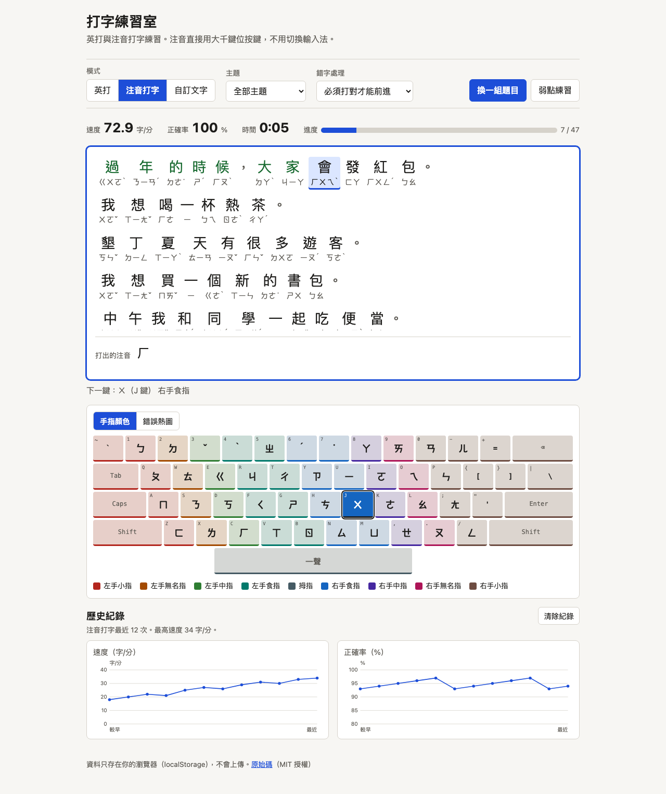

# 打字練習室
A static web app for practicing English typing and Zhuyin (Bopomofo) typing, with live WPM, accuracy, an error heatmap and weak-key drills.



Demo：<https://useless-husband.github.io/type-trainer/>

## 這是什麼

一個純網頁的打字練習室，不用安裝、不用建置、不需要網路。除了英打之外，還可以練「注音打字」：畫面上會顯示中文與注音，你直接用**大千鍵位**按鍵就好，程式自己把按鍵轉成注音來比對，所以不必切換輸入法。

## 功能

- 三種模式
  - 英打：常用單字（1000 字表）、英文句子（114 句）、程式碼片段（50 行）
  - 注音打字：165 句中文練習句（日常、校園、台灣地名與美食），每個字都標注音；按下的注音會同步顯示
  - 自訂文字：貼上任意英文段落練習（會自動把彎引號等打不出來的字元整理掉）
- 即時統計：WPM（中文是「字/分」）、正確率、經過時間、進度條
- 練完顯示結果，並保留最近 30 次的速度與正確率曲線（自己畫的 SVG 圖，存在瀏覽器的 localStorage）
- 虛擬鍵盤：高亮下一個要按的鍵，並用顏色標出該用哪根手指；注音模式時鍵帽上直接顯示注音符號
- 錯誤按鍵熱圖：畫面鍵盤上顏色越深、數字越大，代表那個鍵越常按錯
- 錯字處理可選：「必須打對才能前進」或「可以繼續，最後統計」
- 弱點練習：根據歷史錯誤統計，自動產生包含你最常按錯的鍵的練習內容
- 支援淺色與深色模式，手機寬度也能閱讀（打字本身建議用實體鍵盤）

## 安裝與執行

不需要安裝任何套件。下面兩種方式擇一。

### 方式一：直接用線上版

打開 <https://useless-husband.github.io/type-trainer/> 就能用。

### 方式二：在自己的電腦上跑

因為程式使用 ES module，瀏覽器不允許直接雙擊 `index.html`（`file://`）載入，需要先開一個本機網頁伺服器。電腦上有 Python 3 就可以：

1. 下載這個專案，並在終端機進入資料夾：

   ```bash
   git clone https://github.com/useless-husband/type-trainer.git
   cd type-trainer
   ```

2. 啟動本機伺服器：

   ```bash
   python3 -m http.server 8000
   ```

3. 用瀏覽器打開 <http://localhost:8000>。

4. 不用了就在終端機按 `Ctrl + C` 關掉。

如果你用 Node.js，也可以改用 `npx serve`（需要網路下載一次）。

## 使用說明

1. 上方選「模式」與題庫，畫面會出一組題目。
2. 點一下白色的練習區（會出現藍色外框），然後開始打字。第一個按鍵開始計時。
3. 英打：照著畫面上的字打。大寫字母和符號會提示要用另一隻手的小指按 Shift。
4. 注音打字：照大千鍵位按鍵，**不用切換輸入法**。

   | 要打的 | 按鍵 |
   | --- | --- |
   | 注音符號 | 鍵帽上有寫（例如 ㄅ 是 `1`、ㄆ 是 `Q`、ㄇ 是 `A`、ㄈ 是 `Z`） |
   | 一聲 | 空白鍵 |
   | 二聲 ˊ | `6` |
   | 三聲 ˇ | `3` |
   | 四聲 ˋ | `4` |
   | 輕聲 ˙ | `7`，可以打在注音前面（˙ㄉㄜ）或後面（ㄉㄜ˙） |

   例如「你」是 ㄋㄧˇ，依序按 `S`、`U`、`3`。標點符號不用打，程式會自動跳過。
5. 倒退鍵只能收回目前這個字已經按的鍵；`Esc` 重新出題；`Tab` 離開練習區。
6. 練完會顯示結果，鍵盤自動切成「錯誤熱圖」。按「弱點練習」會依照最近 30 次的錯誤統計出題。
7. 「清除紀錄」會刪掉瀏覽器裡的全部歷史。

## 專案結構

```
type-trainer/
├── index.html            頁面（純靜態，不需建置）
├── style.css             樣式（淺色／深色）
├── src/
│   ├── rng.js            可注入種子的亂數（mulberry32）
│   ├── stats.js          WPM、字/分、正確率
│   ├── keyboard.js       鍵盤配置、每個鍵的手指、字元 → 按鍵
│   ├── zhuyin.js         大千鍵位、音節解析與合法性檢查、按鍵序列
│   ├── session.js        一場練習的狀態機（英打與注音共用）
│   ├── text.js           自訂文字整理、英文單元
│   ├── content.js        依題庫組出一場練習的內容
│   ├── weakness.js       弱點練習產生器
│   ├── history.js        localStorage 歷史存取與壞資料防呆
│   ├── chart.js          SVG 折線圖產生器
│   ├── data/             題庫（單字、英文句子、程式碼、中文句子＋注音）
│   └── ui/               DOM 相關：app.js、keyboard-view.js
├── test/                 node --test 的測試
├── tools/
│   ├── zh-sentences.txt  中文練習句原稿
│   └── build-zh.py       產生 src/data/sentences-zh.js（加上注音）
└── docs/screenshot.png
```

## 如何跑測試

需要 Node.js 20 以上（CI 使用 22），測試沒有任何相依套件：

```bash
node --test "test/*.test.js"
```

測試涵蓋：WPM／正確率計算、注音鍵位轉換與比對（含聲調、一聲空白、輕聲）、題庫格式與注音合法性（每一句的每個音節都必須是合法音節）、弱點練習產生器、歷史資料存取與壞資料防呆、SVG 圖表，以及 `index.html` 的相對路徑與離線檢查。所有用到亂數的地方都可以傳入固定種子的亂數產生器，測試不依賴時間、網路或執行順序。

## 原理簡介

- **練習單元**：`session.js` 把題目拆成「單元」。英打的單元是一個字元；注音的單元是一個音節，例如「你 ㄋㄧˇ」的按鍵序列是 `s`、`u`、`3`。每個單元可以有不只一種按法（輕聲的 `7` 可先可後）。
- **時間由外部傳入**：`press(key, now)` 需要呼叫者給時間，所以計算完全可重現。
- **速度**：英打依慣例每 5 個字元算 1 個字，WPM = 打對的字元數 ÷ 5 ÷ 分鐘；中文是「打對的字數 ÷ 分鐘」。正確率 = (按鍵總數 − 錯誤按鍵數) ÷ 按鍵總數。錯誤按鍵會記在「本來該按的鍵」上，熱圖就是這份統計。
- **兩種錯字模式**：嚴格模式按錯不前進；寬鬆模式按錯會吃掉一格、整個字（或音節）標成錯，繼續往下。
- **注音合法性**：`isValidSyllable` 依聲母類別檢查韻母組合，例如 ㄅㄩ、ㄐㄚ、ㄓㄧ 都不合法。題庫測試會逐句逐音節驗證。
- **弱點練習**：先取最近 30 次紀錄的錯誤加總，找出最常錯的前 5 個鍵；再替每個候選詞（或中文句）計分（含弱點鍵的次數，依錯誤次數加權），最後用固定種子可重現的加權抽樣（Efraimidis–Spirakis）挑出內容。沒有紀錄時退回隨機出題。
- **中文題庫與讀音**：句子都是自己寫的。注音先用 [pypinyin](https://github.com/mozillazg/python-pinyin) 產生，再用 `tools/build-zh.py` 裡的修正表改成台灣讀音（例如「音樂」ㄧㄣ ㄩㄝˋ、「睡覺」ㄕㄨㄟˋ ㄐㄧㄠˋ、「學期」ㄒㄩㄝˊ ㄑㄧˊ、「著」ㄓㄜ˙），並人工抽查。「一」「不」一律標本調（ㄧ、ㄅㄨˋ），不做變調，三聲連讀也不變調，因為輸入時按的是字典上的聲調。要重新產生題庫：`uv run --with pypinyin tools/build-zh.py`（只有開發時需要，網頁不依賴它）。
- **英文題庫來源**：常用 1000 字表取自 [first20hours/google-10000-english](https://github.com/first20hours/google-10000-english)（`google-10000-english-no-swears.txt` 的前 1000 個純字母詞）。該資料源自 Google Web Trillion Word Corpus，經 Peter Norvig 整理；作者聲明教育與個人／研究用途可自由使用，商業用途請自行確認 LDC 授權。英文句子與程式碼片段皆為本專案原創。

## 已知限制

- 注音模式使用實體鍵盤的位置（`KeyboardEvent.code`），採大千（標準）鍵位；不支援倚天、許氏等其他排列。
- 手機或平板的螢幕鍵盤只支援英打，且建議使用實體鍵盤練習。
- 英打題庫以美式 QWERTY 為準；自訂文字中打不出來的字元會被移除。
- 部分輕聲字的標法（如「爸爸」「妹妹」）採教育部辭典的寫法，和個人習慣可能不同。

## 授權

[MIT](LICENSE) © 2026 useless-husband
